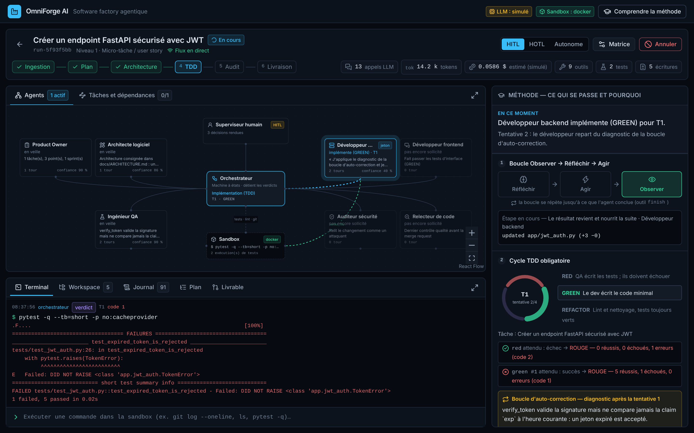

# OmniForge AI

**Software factory agentique** : elle reçoit une user story, un epic ou un cahier des
charges, le planifie, puis le fait réaliser par des agents spécialisés — Product Owner,
Architecte, QA, Développeurs, Auditeur sécurité, Relecteur — sous un cycle TDD obligatoire,
dans une sandbox isolée, avec un niveau de supervision humaine réglable de « je valide
chaque étape » à « zéro contact ».



| | |
|---|---|
| **Agnostique** | Le backend ne connaît que des alias de modèles ; le proxy LiteLLM les associe à Anthropic, OpenAI ou des modèles locaux. Routage selon la nature de la tâche, avec escalade, budget et repli |
| **Rigoureuse** | RED → GREEN → REFACTOR pour chaque tâche. Les tests sont exécutés par l'orchestrateur, jamais crus sur parole, et verrouillés pendant l'implémentation |
| **Gouvernée** | Matrice HITL / HOTL / Autonome, par projet, par étape, modifiable en cours de run |
| **Observable** | Tout est événement dans un journal immuable ; l'IHM explique la méthode pendant qu'elle se déroule |

## Démarrage rapide

Le mode **simulé** fait tourner toute la factory sans aucune clé d'API : les agents sont
scriptés, mais l'orchestration, la sandbox, git et les tests sont réels.

### En ligne de commande

Prérequis : Rust ≥ 1.82, `git`, `bash`, et `pytest` (plus `ruff` pour la phase de refactor).

```bash
cd backend
cargo run -- run "Créer un endpoint FastAPI sécurisé avec JWT" --mode autonomous --sandbox local
```

Vous verrez les tests échouer (RED), une première implémentation incomplète, le diagnostic
de la boucle d'auto-correction, le passage au vert, le refactor, un finding de sécurité
corrigé, puis la merge request. Avec `--mode hitl`, la CLI demande votre décision à chaque
étape clé.

```bash
cargo run -- plan --file ../docs/exemples/prd-reservation.md   # décomposition seule, sans exécution
```

> `--sandbox local` exécute les commandes des agents directement sur votre machine, **sans
> isolation**. C'est acceptable avec le backend simulé, dont le code est connu d'avance.
> Avec de vrais modèles, utilisez la sandbox Docker.

### Avec l'IHM

```bash
# terminal 1 — API
cd backend
OMNIFORGE_SIM_DELAY_MS=400 cargo run -- serve --sandbox local

# terminal 2 — Mission Control
cd web
npm install
npm run dev          # http://localhost:3000
```

### Avec Docker Compose

```bash
cp .env.example .env
echo "DOCKER_GID=$(stat -c '%g' /var/run/docker.sock)" >> .env
docker compose up --build          # IHM : http://localhost:3000 — API : http://localhost:8080
```

Chaque run s'exécute alors dans son propre conteneur : sans réseau, sans capacité Linux,
mémoire, CPU et nombre de processus bornés.

### Avec de vrais modèles

1. Renseignez `ANTHROPIC_API_KEY`, `OPENAI_API_KEY` et `LITELLM_MASTER_KEY` dans `.env`,
   puis `OMNIFORGE_LLM_MODE=gateway`.
2. Vérifiez les modèles associés aux alias dans [`config/litellm.config.yaml`](config/litellm.config.yaml).
3. `docker compose --profile llm up --build` (ajoutez `--profile local-models` pour Ollama).

Ce chemin a été vérifié contre un proxy LiteLLM réel, mais **jamais contre de vrais
modèles** : voir [l'état du MVP](#état-du-mvp).

## Les trois niveaux d'entrée

| Niveau | Exemple | Résultat de la planification |
|---|---|---|
| 1 — micro-tâche | « Créer un endpoint FastAPI sécurisé avec JWT » | Une tâche, un cycle TDD |
| 2 — epic | « Implémenter le module de facturation avec Stripe, webhooks et dashboard » | Un socle et une tâche par livrable, dépendances vers le socle |
| 3 — cahier des charges | Document Markdown, texte ou PDF | Arbre objectif → epics → tâches, dépendances, risques, plan de sprints |

```text
$ omniforge plan "Implémenter le module de facturation avec Stripe, webhooks et dashboard"
Niveau 2 — Epic fonctionnelle (3 livrables énumérés dans la demande)

- [G] Implémenter le module de facturation avec Stripe, webhooks et dashboard
  - [E1] Implémenter le module de facturation avec Stripe, webhooks et dashboard
    - [T1] Socle : Implémenter le module de facturation (3 pts, risque 8)
    - [T2] Stripe (3 pts, risque 8)  ← T1
    - [T3] Webhooks (3 pts, risque 6)  ← T1
    - [T4] Dashboard (2 pts, risque 2)  ← T1

Ordre d'exécution : T1 → T2 → T3 → T4
Chemin critique   : T1 → T2
Sprint 1 (11 pts, risque max 8) : T1, T2, T3, T4
```

## Supervision à la carte

| Mode | Comportement |
|---|---|
| **HITL** — supervisé | Pause obligatoire à chaque étape clé : plan, architecture, plan de test, merge request |
| **HOTL** — par exception | Autonome ; pause seulement si la confiance d'un agent passe sous le seuil, si une règle de sécurité est violée, si les tests restent rouges après N itérations ou si le budget est atteint |
| **Autonome** — zéro contact | Aucune pause. Une exception bloquante fait échouer le run au lieu de livrer |

La politique se fixe par run et se modifie pendant le run. Exemple : tout automatique, mais
un humain sur la merge request finale, avec un plafond de dépense.

```json
{
  "default_mode": "autonomous",
  "stage_overrides": { "merge": "hitl" },
  "confidence_threshold": 0.7,
  "max_tdd_iterations": 4,
  "budget_usd": 5.0,
  "block_on_severity": "high"
}
```

## Documentation

| Document | Contenu |
|---|---|
| [1. Architecture](docs/01-architecture.md) | Composants, schéma, routage multi-modèles, sécurité, décisions, périmètre réel du MVP |
| [2. Cycle de vie d'une tâche](docs/02-cycle-de-vie.md) | Du cahier des charges à la merge request, boucle TDD, matrice de supervision |
| [3. Agents](docs/03-agents.md) | Rôles, personas, entrées, sorties, outils, garde-fous |
| [4. IHM](docs/04-ihm.md) | Vues, composants, flux de données de Mission Control |

## Organisation du dépôt

```text
backend/               moteur Rust : orchestrateur, agents, routeur LLM, sandbox, API, CLI
  src/orchestrator/      machine à états du SDLC, boucle TDD, projection d'état
  src/governance/        matrice de supervision, portails, scanner de sécurité
  src/llm/               routeur, client de passerelle, backend simulé
  src/ingestion/         classification, planification HTN, risques, sprints
  src/sandbox/           sandbox Docker durcie, sandbox locale, workspace
  tests/                 tests de bout en bout, API, passerelle, Docker
web/                   IHM Mission Control (Next.js, Tailwind, React Flow)
config/
  omniforge.toml         routage, supervision par défaut, limites de sandbox
  litellm.config.yaml    alias → modèles des fournisseurs
sandbox/Dockerfile     image dans laquelle les agents exécutent leurs commandes
docker-compose.yml     pile complète
docs/                  documentation et exemples
```

## Configuration

| Variable | Défaut | Rôle |
|---|---|---|
| `OMNIFORGE_LLM_MODE` | `simulated` | `simulated` (hors-ligne) ou `gateway` (proxy LiteLLM) |
| `OMNIFORGE_LLM_BASE_URL` | `http://localhost:4000/v1` | Adresse de la passerelle compatible OpenAI |
| `OMNIFORGE_LLM_API_KEY` | — | Clé présentée à la passerelle |
| `OMNIFORGE_SANDBOX` | `docker` (profil) | `docker` ou `local` (sans isolation) |
| `OMNIFORGE_CONFIG` | valeurs intégrées | Chemin d'un profil TOML ([`config/omniforge.toml`](config/omniforge.toml)) |
| `OMNIFORGE_DATA_DIR` | `./data` | Journal d'événements et workspaces des runs |
| `OMNIFORGE_BIND` | `127.0.0.1:8080` | Adresse d'écoute de l'API |
| `OMNIFORGE_API_KEY` | — | Clé statique exigée des clients. Sans elle, l'API est ouverte : à réserver au poste local |
| `OMNIFORGE_CORS_ORIGINS` | `http://localhost:3000,http://127.0.0.1:3000` | Origines navigateur autorisées ; les écritures et le flux temps réel venant d'une autre origine sont refusés |
| `OMNIFORGE_SIM_DELAY_MS` | `0` | Latence artificielle des agents simulés, pour suivre la démo |

## API

| Méthode et chemin | Rôle |
|---|---|
| `POST /api/runs` | Lancer un run à partir d'un texte |
| `POST /api/runs/upload` | Lancer un run à partir d'un document `.md`, `.txt` ou `.pdf` |
| `POST /api/plan` | Classifier et décomposer sans exécuter |
| `GET /api/runs` · `GET /api/runs/{id}` | Liste des runs · état complet d'un run |
| `GET /api/runs/{id}/stream?since=` | WebSocket : rejeu puis événements en direct |
| `GET /api/runs/{id}/events?since=` | Les mêmes événements, en interrogation |
| `POST /api/runs/{id}/gates/{gate}/resolve` | Décision humaine : `approve`, `request_changes`, `reject` |
| `PUT /api/runs/{id}/supervision` | Modifier la politique de supervision en cours de run |
| `POST /api/runs/{id}/terminal` | Exécuter une commande dans la sandbox du run |
| `GET /api/runs/{id}/workspace/{tree,file,diff}` | Fichiers, contenu, diff cumulé |
| `POST /api/runs/{id}/cancel` | Arrêter le run |
| `GET /api/meta` | Rôles, outils, table de routage, politique par défaut |

## Tests

```bash
cd backend
cargo test                                   # unitaires, bout en bout, API, passerelle
docker build -t omniforge-sandbox:latest ../sandbox
OMNIFORGE_TEST_DOCKER=1 cargo test --test docker   # isolation réelle de la sandbox

cd ../web
npm run lint && npm run build
```

Les tests de bout en bout lancent de vrais runs : agents scriptés, mais vrai dépôt git,
vraie exécution de `pytest` et de `ruff`.

## État du MVP

Le cœur est en place et testé : pipeline complet, boucle TDD avec auto-correction, matrice
de supervision, routage multi-modèles, sandbox Docker, ingestion et planification, API
temps réel, IHM.

Les limites à connaître avant de s'appuyer dessus :

- **Aucun run n'a été exécuté avec de vrais modèles** — aucune clé fournisseur n'était
  disponible pendant le développement. Le protocole est vérifié (faux serveur compatible
  OpenAI, proxy LiteLLM réel en mode simulé) ; la qualité des prompts reste à valider.
- Le backend simulé n'écrit du vrai code que pour le scénario JWT ; les autres tâches
  produisent un gabarit de démonstration.
- Les tâches s'exécutent une par une, même quand le plan les déclare parallélisables.
- La merge request est locale au workspace du run : rien n'est poussé vers une forge.
- Projets neufs uniquement ; chaîne de test Python par défaut.

Le détail et les pistes d'évolution sont dans [docs/01-architecture.md](docs/01-architecture.md#18-périmètre-réel-du-mvp).
