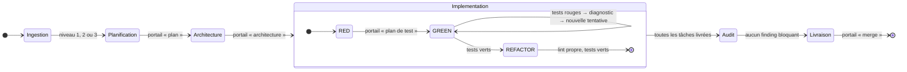
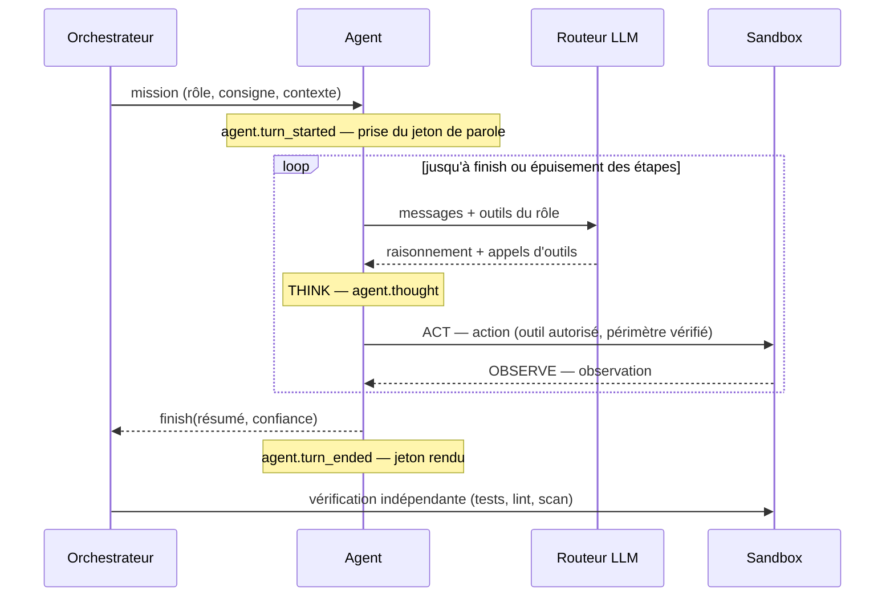

# 2. Cycle de vie d'une tâche

Du cahier des charges à la merge request validée, étape par étape. Chaque étape indique qui
agit, ce que l'orchestrateur vérifie lui-même, les événements émis et le point de contrôle
soumis à la matrice de supervision.

## 2.1 Vue d'ensemble



Un run se trouve à tout instant dans l'un de ces statuts : `pending`, `running`,
`waiting_approval` (un portail attend une décision), `completed`, `failed` (arrêt décidé par
la factory), `cancelled` (arrêt décidé par un humain) ou `interrupted` (le processus s'est
arrêté pendant le run).

## 2.2 Déroulé pas à pas

L'exemple suit un cahier des charges Markdown de trois sections et sept exigences.

### Étape 0 — Soumission

`POST /api/runs` (texte) ou `POST /api/runs/upload` (fichier `.md`, `.txt` ou `.pdf`, converti
par `pdftotext`). La politique de supervision du run est fournie, sinon celle de la factory
s'applique. Une demande vide, un niveau hors 1-3 ou une politique invalide sont refusés
sans laisser de trace. → `run.created`

### Étape 1 — Ingestion et classification

L'orchestrateur démarre la sandbox, y initialise un dépôt git (`main`) et crée la branche
de travail `omniforge/<run-id>`. Le classifieur déterministe évalue la granularité :

| Niveau | Signal | Workflow de planification |
|---|---|---|
| 1 — micro-tâche | Demande courte et atomique | Un objectif, une tâche |
| 2 — epic | Livrables énumérés (« … avec A, B et C »), liste d'exigences, périmètre fonctionnel | Un epic, un socle et une tâche par livrable |
| 3 — cahier des charges | Document structuré (sections + exigences), texte long, vocabulaire de spécification | Arbre objectif → epics → tâches |

Le niveau peut être imposé par l'utilisateur. → `ingestion.classified` (niveau, justification, signaux)

### Étape 2 — Planification (Product Owner)

Le Product Owner produit un **réseau hiérarchique de tâches** : nœuds, critères
d'acceptation testables, dépendances, estimation en points, risque (probabilité × impact,
facteurs, mitigation). Le modèle propose ; l'orchestrateur valide et ordonnance
(`ingestion/htn.rs`), sans jamais déléguer d'algorithme de graphe à un LLM :

1. réparation du graphe — identifiants uniques, dépendances inconnues écartées, dépendances
   sur un epic étendues à ses tâches, cycles rompus (chaque réparation devient un avertissement) ;
2. **vagues** d'exécution (tri topologique) et ordre d'exécution ;
3. **chemin critique** (plus longue chaîne pondérée par les estimations) ;
4. **plan de sprints** : chaque tâche va dans le premier sprint ayant de la capacité et
   situé après ceux de ses dépendances.

Si le plan du modèle est inexploitable (pas de JSON, tâche sans critère d'acceptation), le
planificateur heuristique prend le relais avec une confiance plafonnée à 60 %.
→ `plan.created` · **portail `plan`**

### Étape 3 — Architecture (Architecte)

L'architecte explore le workspace puis rédige `docs/ARCHITECTURE.md` : décisions et
compromis, composants, interfaces, modèle de données, stratégie de test. Il ne peut écrire
que dans `docs/`. L'orchestrateur committe le document ; un document absent ou un agent qui
ne conclut pas plafonne la confiance à 40 %. → `artifact.created` · **portail `architecture`**

### Étape 4 — Implémentation : un cycle TDD par tâche

Les tâches sont traitées dans l'ordre des dépendances.

**RED — QA écrit les tests.** L'agent QA traduit les critères d'acceptation en tests ; il ne
peut écrire que des fichiers de test. L'orchestrateur exécute ensuite **uniquement les
nouveaux tests** et exige qu'ils échouent pour la bonne raison :

| Constat | Verdict |
|---|---|
| Échecs ou erreur d'import (le module n'existe pas encore) | RED valide |
| Les tests passent déjà | Rejet : ils ne vérifient rien, ou la fonctionnalité existe |
| Aucun test écrit ou collecté, erreur de syntaxe, délai dépassé | Rejet |

Un rejet renvoie le motif à QA pour une seconde tentative ; un second rejet lève
l'exception bloquante `vacuous_tests`. Les tests sont commités (`test(red): …`), puis
**verrouillés**. → `tdd.test_result` · **portail `test_plan`**

**GREEN — le développeur implémente.** Il lit les tests, écrit le code de production,
exécute la suite. Toute tentative de modifier un test est refusée ; si un test a malgré
tout été altéré par le shell, il est restauré et la violation est tracée. Puis
l'orchestrateur relance **toute la suite** :

- *verte* → commit `feat(green): …`, passage au refactor ;
- *rouge* → **boucle d'auto-correction** : un modèle critique, d'un autre palier, analyse la
  trace et le code et produit un diagnostic structuré (cause racine, correctif). Ce
  diagnostic est mémorisé comme leçon et transmis au développeur pour la tentative
  suivante. Toutes les deux tentatives ratées, le développeur monte d'un palier de modèle.

Après `max_tdd_iterations` tentatives (4 par défaut), la boucle est déclarée divergente :
exception `tdd_divergence` · **portail `implementation`**. Le superviseur peut accorder des
itérations, donner des indications ou arrêter.
→ `tdd.phase_changed`, `tdd.test_result`, `tdd.reflection`

**REFACTOR — lint.** L'orchestrateur exécute le linter. S'il signale des défauts, le
développeur les corrige avec un modèle du palier « routine », puis la suite est relancée.
Verte : commit `refactor: …`. Rouge : le refactor est jeté et l'on revient au commit vert.

La confiance de la tâche combine un signal objectif (le nombre de tentatives nécessaires)
et l'auto-évaluation des agents. → `task.status_changed`

### Étape 5 — Audit

L'auditeur sécurité et le relecteur de code examinent le changement **en parallèle**, en
lecture seule, pendant que le scanner statique déterministe passe sur le workspace. Les
findings d'une sévérité supérieure ou égale au seuil (`high` par défaut) sont bloquants :

1. le développeur corrige, tests verrouillés (un correctif qui casse les tests est jeté) ;
2. nouveau scan — et nouvel audit LLM si c'est l'auditeur qui avait levé le finding ;
3. après deux tours sans succès : exception `security_violation` · **portail `security`**
   (accepter le risque avec dérogation tracée, relancer avec indications, ou arrêter).

Si le relecteur demande des modifications, une passe de révision est faite, conservée
seulement si les tests restent verts. → `security.findings`

### Étape 6 — Livraison

L'orchestrateur relance une dernière fois toute la suite — on ne livre jamais sur un
verdict ancien — puis assemble la merge request : titre, description (tâches, tentatives,
vérifications, findings, dérogations, coût), commits, diff. La confiance globale agrège
celle des tâches, celle du relecteur et l'état de sécurité. · **portail `merge`**

Une demande de modification déclenche une passe de révision puis un nouveau passage au
portail. Approuvée, la merge request est publiée comme artefact. → `artifact.created`, `run.status_changed: completed`

## 2.3 La boucle Observe → Think → Act

Chaque intervention d'agent est une boucle bornée (`max_steps`, 16 par défaut) :



L'agent conclut par `finish(résumé, confiance)`. Une confiance basse est une information
utile : en HOTL, elle déclenche un portail.

## 2.4 Matrice de supervision

À chaque point de contrôle, le GateKeeper parcourt le même arbre de décision :

```text
mode de l'étape (surcharge par étape, sinon mode par défaut)
│
├─ HITL ──── étape clé (plan, architecture, plan de test, merge) ? ── oui ─▶ PAUSE
│            └─ non : exception présente ? ── oui ─▶ PAUSE ── non ─▶ poursuite
│
├─ HOTL ──── exception présente ? ── oui ─▶ PAUSE ── non ─▶ poursuite
│
└─ AUTONOME ─ exception bloquante ? ── oui ─▶ ARRÊT du run (échec, aucune livraison)
              └─ non : poursuite (exception non bloquante consignée)
```

| Exception | Déclencheur | Bloquante |
|---|---|---|
| `low_confidence` | Confiance sous le seuil (70 % par défaut) | non |
| `policy_violation` | Commande refusée, écriture hors périmètre, test verrouillé modifié | non (l'action a déjà été empêchée) |
| `vacuous_tests` | Phase RED invalide après deux tentatives | oui |
| `tdd_divergence` | Tests toujours rouges après N itérations | oui |
| `security_violation` | Findings bloquants non résolus | oui |
| `budget_exceeded` | Plafond de dépense LLM atteint | oui |

Trois décisions sont possibles à un portail : **approuver**, **demander des modifications**
(le commentaire est transmis à l'agent, qui refait l'étape ; `max_revisions` tours au plus)
ou **rejeter** (le run passe à `cancelled`). Un portail peut expirer (`gate_timeout_s`) : il
n'est jamais approuvé par défaut, et le run se termine en échec (`failed`).

La politique se règle par projet, par run, et **en cours de run** : la modification
s'applique dès le point de contrôle suivant. Exemple vérifié par les tests : un run
autonome qui garde un humain sur la seule merge request (`stage_overrides = { merge = "hitl" }`).

## 2.5 Exemple réel : la micro-tâche « endpoint sécurisé avec JWT »

Sortie condensée de `omniforge run "Créer un endpoint FastAPI sécurisé avec JWT" --mode autonomous`
(backend simulé, vraie sandbox, vrais tests) :

```text
━━━ PLANNING ━━━       1 tâche, 3 points, confiance 90 %                 → poursuite automatique
━━━ ARCHITECTURE ━━━   docs/ARCHITECTURE.md, confiance 86 %              → poursuite automatique
━━━ IMPLEMENTATION ━━━
  RED       QA écrit tests/test_jwt_auth.py     tests ROUGES (attendu)   ✓
  GREEN 1   dev écrit app/jwt_auth.py           5 réussis, 1 échoué      ✗
            diagnostic : verify_token ne compare jamais `exp` à l'heure courante
  GREEN 2   dev applique le correctif           6 réussis                ✓
  REFACTOR  import inutilisé retiré (ruff)      6 réussis                ✓
━━━ AUDIT ━━━          1 finding bloquant : comparaison de signature non constante
                       correctif : hmac.compare_digest ; tests verts ; 0 finding
━━━ DELIVERY ━━━       suite complète verte → merge request omniforge/run-… → main
```

L'historique git du workspace reflète le cycle :
`test(red)` → `feat(green)` → `refactor` → `fix(security)`.
